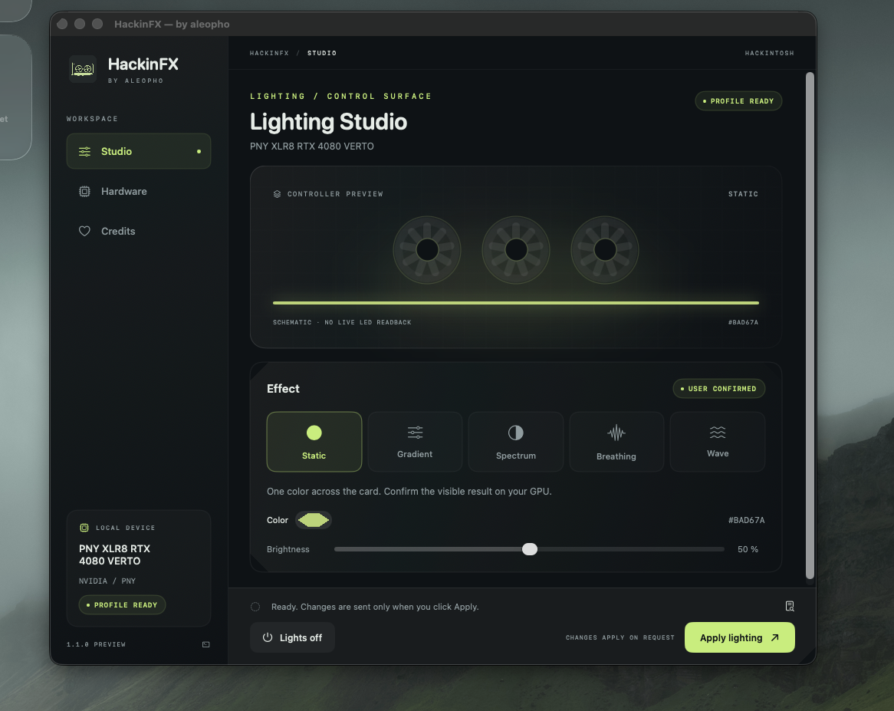

<p align="center"></p>
<h1 align="center">HackinFX</h1>
<p align="center">RGB Control Center for Hackintosh systems · by <a href="https://github.com/aleopho">aleopho</a></p>

HackinFX is a native macOS RGB Control Center by **aleopho** for x86-64
Hackintoshes with an Intel or AMD CPU. It combines the bundled **OpenRGB 1.1
macOS engine** with native NVIDIA, USB/HID and scoped DRAM adapters.

This branch contains **2.1.0**: live lighting, nine shared effects, a refined
lighting-first interface, launch at login, white on startup, update checks and
an installer with optional automatic OpenCore SMBus setup.
[Changes and exact validation limits](docs/RELEASE-2.0.3.md).

## Install

The 2.0.3 PKG installs HackinFX into **Applications**. Quit older copies first.
Under **Customize**, the optional **OpenCore SMBus driver (RAM RGB)** component
finds the boot EFI, backs it up, copies macUSPCIO and activates its Kernel/Add
entry. It stops on ambiguity; reboot after installing this component.
[OpenCore setup and recovery](docs/RAM-SETUP.md).

The last published release remains [1.1.1](https://github.com/aleopho/HackinFX/releases/tag/v1.1.1)
until the Control Center hardware validation is complete. GitHub Actions on this
branch produces the 2.1.0 PKG and DMG, including the real WidgetKit extension.

Requirements:

- **macOS 15 or later**, x86-64 Hackintosh; no ARM build. CPU vendor is not a gate.
- Working macOS device access. OpenRGB's macOS drivers are bundled; a device
  being supported on Windows does not guarantee access on macOS.
- Native NVIDIA control additionally requires the separately installed
  [NullMoth NVRM driver](https://github.com/nullmoth/nvidia-macos-driver).
- Native/SMBus DRAM access additionally requires a compatible host/module and
  the macUSPCIO transport. The initial native RAM adapter is narrowly scoped;
  generic RAM compatibility is not claimed.
- A working `/usr/bin/python3` supplied with Apple's command line tools.

The app, helpers and nested engine are locally **ad-hoc signed**, not Developer
ID signed or notarized. Downloaded packages/apps may need macOS approval.

## Control Center

- OpenRGB starts and stops with HackinFX on a local-only SDK port; no separate
  installation, manual server configuration, remote plugins or account needed.
- Ready devices receive **static white at 100% once per app/Core session**.
  Later rediscovery does not reset colors. Unknown/unconfirmed devices are
  never granted lighting access from a catalog match alone.
- Changes go live after a short debounce; no Apply button. Static, Gradient,
  Spectrum, Breathing, Wave, Aurora, Comet, Twinkle and Color shift are available
  according to each adapter's capabilities. Direct-mode OpenRGB devices can
  stream shared per-LED effects; hardware-mode-only devices remain visible.
- Launch at login is managed through macOS Login Items after first launch from
  Applications. White is applied **after sign-in**, not before the login screen.
- Profiles/scenes live in `~/Documents/HackinFX`. Logs and private engine state
  live in `~/Library/Application Support/HackinFX/Core`.
- Window close keeps the menu-bar app running. Quit stops its Core and child
  engine. Hardware inventory, explicit diagnostics/report submission and guided
  native-GPU visual confirmation remain available under advanced tools.
- Radius callback lifetime crash is fixed in source; its lighting still needs
  physical verification. The blank desktop widget remains an open issue.

## Native GPU compatibility

The OpenRGB identity catalog recognizes 752 GPU PCI tuples. Native executable
paths cover PNY Lovelace, EVGA Pascal, ASUS Aura and the controller families
implemented in this branch; a catalog identity is not a transport or a verified
lighting result. Native GPU writes require successful visual confirmation.

## Verified hardware

| Card | GPU vendor | Board vendor | PCI / subsystem | Confirmed functions |
| --- | --- | --- | --- | --- |
| PNY XLR8 RTX 4080 VERTO | NVIDIA | PNY | `10de:2704 / 196e:13bc` | Static, Gradient, Spectrum, Breathing, Wave |

CPU vendor and GPU vendor are separate: an AMD CPU is not an AMD graphics card. The x86-64 build is not restricted to Intel CPUs; actual operation still depends on the macOS/NullMoth/GPU configuration. AMD-CPU compatibility has not been physically verified.

These lighting effects were visually confirmed by aleopho on the development card. Off is implemented but has not been separately visually confirmed. A successful driver return value does not prove that LEDs changed.

Other GPUs can be inventoried and reported, but lighting writes remain disabled until a compatible local controller/transport module is implemented and validated. See [compatibility and adding GPUs](docs/COMPATIBILITY.md).

## Native GPU confirmation and community reports

1. Shows a short launch animation, then visibly reads PCI identity and graphics-driver information.
2. Loads a previously confirmed local profile when the hardware/driver/OS fingerprint matches. Older basic-only profiles require the complete test.
3. Otherwise, for an implemented controller, automatically tests red, green, blue and every available effect. PNY offers Gradient, Spectrum, Breathing and Wave; EVGA Pascal/ASUS Aura offer Spectrum and Breathing. Watch the card and confirm complete, partial or no operation. The test can be stopped.
4. Saves a reusable local profile only after completed transport calls and your visual confirmation. Missing or incorrect board/model names can be supplied by the user; detected PCI IDs are preserved.
5. With sharing enabled, queues a minimal compatibility confirmation for the community database. Offline submissions remain local and retry automatically. Private troubleshooting notes require a separate **Review / Send** action.

Closing the window keeps HackinFX in the menu bar. Open Lighting restores it; **Quit HackinFX** exits. Static/zone colors, brightness and effect speed are available in the lighting studio. Gradients use three controller zones; physical placement depends on the card.

## Desktop widget

The genuine WidgetKit extension is included. Desktop display is currently reported blank and is still under investigation. Its intended snapshot shows GPU model, last successfully applied lighting mode, a matching color strip and brightness where supported. Add HackinFX from the desktop’s **Edit Widgets** gallery after installing and launching the app. WidgetKit controls refresh timing; the colors are a schematic of the last command, not live LED feedback. Normal desktop registration and update behavior still need community validation with the ad-hoc-signed distribution.

## Screenshots



HackinFX 1.1.0 Lighting Studio with the confirmed PNY XLR8 RTX 4080 VERTO profile. Genuine desktop capture supplied by aleopho before the 1.1.1 corrections; the visible 1.1.0 PREVIEW footer is removed in the current release; the GPU illustration inside the app is a schematic, not LED-state feedback. [Screenshot details](docs/SCREENSHOTS.md).

## Documentation

- [Installation, first launch and troubleshooting](docs/USER-GUIDE.md)
- [How hardware access and effects work](docs/ARCHITECTURE.md)
- [Compatibility and the process for adding a card](docs/COMPATIBILITY.md)
- [Reports, privacy and the public catalog](docs/PRIVACY.md)
- [Build, tests and release validation](docs/DEVELOPMENT.md)
- [Report server deployment](report-inbox/README.md)
- [Licenses, third-party code and acknowledgements](THIRD-PARTY-NOTICES.md)
- [Release history](CHANGELOG.md)

## Source layout

```text
app/                 SwiftUI/AppKit app, Python transport, profiles, tests, assets
report-inbox/        Cloudflare Worker, D1 schema, migrations and backend tests
docs/                User, architecture, compatibility, privacy and developer docs
licenses/            Preserved third-party notices
LICENSE              Full GPL version 2 text; project permits version 2 or later
```

Prepare pinned engine/source inputs with `python3 tools/prepare_openrgb_runtime.py`, then build with `python3 app/build_community.py` (full Xcode for WidgetKit). Package with `python3 app/package_installer.py`. [Build checks](docs/RELEASE-2.0.3.md).

## Credits and license

Created by **aleopho**. HackinFX application/source: **GPL-2.0-or-later**, see [LICENSE](LICENSE) and [licensing notes](app/LICENSE.md).

- **OpenRGB / yufan, Adam Honse, Jan Rettig and contributors:** PNY Lovelace, EVGA Pascal and ASUS Aura controller adaptations, GPL-2.0-or-later.
- **NullMoth Systems:** separately installed NVRM bridge; the reviewed v2.5.3 NVRM source declares PolyForm Noncommercial 1.0.0. Its driver is not bundled or relicensed by HackinFX.
- **NVIDIA:** public RM SDK ABI definitions, with MIT notices preserved in [licenses/NVIDIA-MIT.txt](licenses/NVIDIA-MIT.txt).

[Full attribution and source references](THIRD-PARTY-NOTICES.md). Independent community project; no endorsement by Apple, NVIDIA, PNY, NullMoth or OpenRGB. Provided without warranty.

Confirmed profiles are saved in the current user’s `~/Documents/HackinFX/` directory, one JSON file per hardware fingerprint. Existing matching profiles are migrated automatically.

### Control Center development build 2.0.3

Bundled OpenRGB 1.1 macOS engine, live lighting, white on app/login launch, nine
shared effects, a lighting-first interface, update checks and a macOS 15+ x86-64
PKG installer. See [changes, build instructions and validation limits](docs/RELEASE-2.0.3.md).
The current public release is separate from this development branch; device
control still requires a working macOS driver, not merely a catalog entry.

### 2.1.0 Canvas and clock synchronization

Dedicated Canvas and Effect Studio replace the duplicated Scenes/Layout areas.
Host-streamed effects share one persistent timeline, parallel output workers and
a bounded latest-frame policy. Hardware-only modes remain separately timed and
are excluded from strict Canvas streaming. Update checks run automatically at
launch and remain available under Software Update. The installer uses OpenCore
boot-path NVRAM and offers explicit EFI selection when automatic selection is
ambiguous. Radius discovery/control is now user-confirmed on the development
machine (2026-10-26), without a claim that all firmware/topologies are tested.

### 2.1.1 regression repairs

Lighting launch/selection, strict Canvas filtering, Radius static-color renewal,
MBR/USB OpenCore boot discovery (including the development boot volume 1401),
a parameter-editable Effect Studio and a rebuilt single WidgetKit view fed by
Core state. See [2.1.1 behavior and physical validation limits](docs/RELEASE-2.1.1.md).
