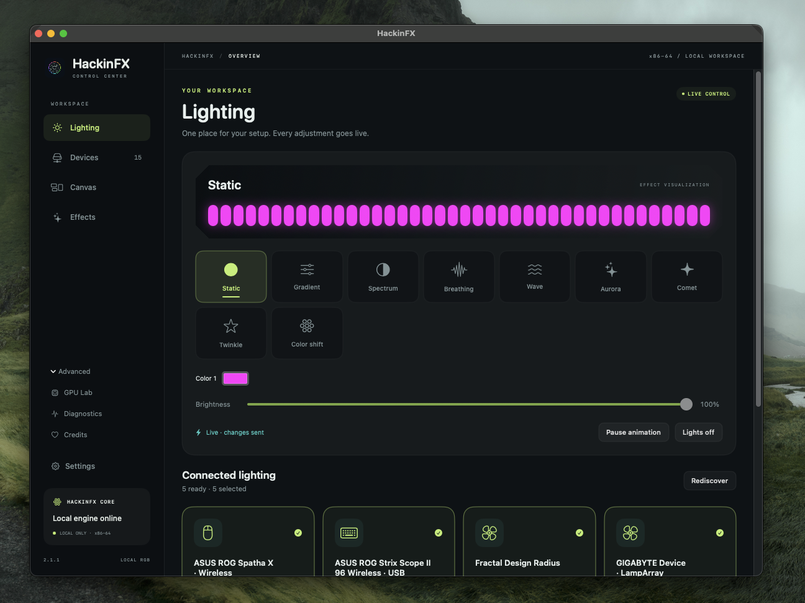

<p align="center"></p>
<h1 align="center">HackinFX</h1>
<p align="center">Lighting Studio for macOS Hackintosh systems · by <a href="https://github.com/aleopho">aleopho</a></p>
<p align="center"><a href="https://github.com/aleopho/HackinFX/releases/latest">Download</a> · <a href="docs/USER-GUIDE.md">Getting started</a> · <a href="docs/COMPATIBILITY.md">Device compatibility</a> · <a href="THIRD-PARTY-NOTICES.md">Licenses & credits</a></p>

HackinFX brings GPUs, keyboards, mice, USB lighting controllers and supported
coolers into one native **Lighting Studio**. Built for **macOS 15 or later** on
**x86-64 Hackintoshes with Intel or AMD CPUs**, it combines the bundled
**OpenRGB 1.1 macOS engine** with native NVIDIA and USB/HID adapters.

**Current release: [2.1.1](https://github.com/aleopho/HackinFX/releases/tag/v2.1.1).**
RAM RGB is under development and is **not yet working on the development system**.
Apple Silicon is outside the current target.



Actual desktop screenshot supplied by aleopho on 26 October 2026. The effect
visualization shows requested colors, not optical LED feedback.

## One workspace for your lighting

- **Live lighting:** Static, Gradient, Spectrum, Breathing, Wave, Aurora, Comet,
  Twinkle and Color shift, with palette, brightness and tempo controls. Changes
  apply automatically; there is no Apply button.
- **Shared effects:** mirrored group output uses a shared timeline and frame
  barrier. Faster outputs are delayed using measured command durations; the
  slowest device sets group throughput. Actual LED timing depends on hardware.
- **Canvas:** arrange devices in a shared effect space or mirror a look across
  the setup. Only outputs with a suitable streaming path join animated groups.
- **Effect Studio:** edit palettes and effect parameters, preview and save looks.
- **OpenRGB inside:** the pinned macOS engine and its compiled device drivers
  start locally with HackinFX. No separate OpenRGB installation or account.
- **Native paths:** confirmed NVIDIA profiles, HID LampArray, ASUS Spatha X,
  ASUS keyboard whole-board color, Fractal Radius and scoped NZXT support.
- **Daily use:** launch at login, white on app/login startup, persistent menu-bar
  controls and software-update checks. Closing the window keeps lighting active.
- **Diagnostics & feedback:** fresh hardware specifications, device status and
  your description, reviewed before private submission; JSON export remains available.
- **WidgetKit:** mode, palette, brightness, GPU model, ready-device count and
  attention state. Desktop rendering and refresh behavior need wider validation.

## Install

Download the **[2.1.1 installer](https://github.com/aleopho/HackinFX/releases/download/v2.1.1/HackinFX-2.1.1-Installer.pkg)**,
quit older copies and install into **Applications**. A DMG is also available.
Launch the installed app, let discovery finish and inspect **Devices** for ready
outputs or setup requirements. Ready devices are selected and set to white at
100% once per app/Core session. Login startup applies white after sign-in, not
before the macOS login screen.

Requirements:

- macOS 15+, x86-64. Intel and AMD CPU systems are in scope; AMD-CPU operation
  has not been independently verified on physical hardware by this project.
- A working `/usr/bin/python3` from Apple's command line tools.
- Device access supported on macOS. An OpenRGB catalog match or working Windows
  driver does not prove that macOS can control the device.
- For native NVIDIA lighting: separately install the
  [NullMoth NVRM driver](https://github.com/nullmoth/nvidia-macos-driver).
  It is not required for every USB device and is not bundled.

The installer offers **Customize → OpenCore SMBus driver (RAM RGB)**. This is an
optional development transport, not a guarantee of working RAM lighting. It
backs up the EFI before adding the driver/config entry, recognizes GPT and
FAT/MBR boot volumes, and requires reboot. **Do not install it just to use USB
lighting.** Read [RAM setup and recovery](docs/RAM-SETUP.md) first.

App, helpers, widget and nested engine are **ad-hoc signed**, without Apple
Developer ID or notarization. macOS may require approval for downloaded software.

## Device coverage: detection is not control

| Device class | Included paths | Current evidence / limits |
| --- | --- | --- |
| NVIDIA GPUs | 68 exact native test profiles across PNY Lovelace, ASUS Aura, EVGA Pascal/Turing and Zotac Turing; OpenRGB paths where available | PNY XLR8 RTX 4080 VERTO visually confirmed; other native profiles need their own test and confirmation |
| Keyboards | OpenRGB macOS drivers, native HID LampArray and ASUS Scope II 96 / supported OMNI paths | Scope II 96 USB appears ready on the development setup; native ASUS output is whole-keyboard RGB, not per-key |
| Mice | OpenRGB macOS drivers and native ASUS Spatha X | Spatha X user-reported working; connection mode and firmware can differ |
| Mainboards / controllers | OpenRGB macOS drivers and native HID LampArray | Development GIGABYTE LampArray user-reported working; no universal board claim |
| USB cooling / lighting | OpenRGB macOS drivers, native Fractal Radius and NZXT Kraken X2/M2 paths | Radius user-reported working; sustained color and timing need broader firmware testing; NZXT not physically verified here |
| DRAM | Scoped Corsair Titanium / SMBus development path and available OpenRGB paths | **Not yet working on the development system. No general RAM support claim.** |

The OpenRGB identity catalogs help name devices. They do not download drivers,
turn every catalog entry into a controllable output or bypass exact native
hardware guards. [Compatibility details and contribution process](docs/COMPATIBILITY.md).

## Profiles, feedback and privacy

Confirmed native GPU profiles and saved scenes use **`~/Documents/HackinFX`**.
Core logs and private state use `~/Library/Application Support/HackinFX/Core`.
Native GPU Lab tests implemented controllers and saves a reusable profile only
after successful calls and your visual confirmation. Manual identity corrections
retain the original detected PCI identity.

Under **Advanced → Diagnostics**, describe the problem in **Feedback &
compatibility**, then choose **Scan & submit feedback…**. A fresh read-only scan
attaches allowlisted CPU, RAM, USB, PCI and storage specifications, alongside
Core device/error details. Review the JSON before sending. Serials, raw device
trees, volume labels and mount paths are excluded from this inventory; free text
is sent as typed. The existing private HTTPS report inbox returns a receipt.
SourceForge ticket submission is not integrated. Reports require investigation;
they do not automatically create driver support in the next release.
[Data flow and privacy](docs/PRIVACY.md).

## Documentation

- [Installation and everyday use](docs/USER-GUIDE.md)
- [Devices, tests and compatibility](docs/COMPATIBILITY.md)
- [Core, engine and synchronization architecture](docs/ARCHITECTURE.md)
- [RAM / OpenCore setup and recovery](docs/RAM-SETUP.md)
- [USB lighting](docs/USB-LIGHTING.md) · [Radius and ASUS keyboard](docs/RADIUS-AND-KEYBOARD.md)
- [Build and release checks](docs/DEVELOPMENT.md)
- [Report service](report-inbox/README.md) · [Contributing](CONTRIBUTING.md)
- [Release notes](docs/RELEASE-NOTES-2.1.1.md) · [Changelog](CHANGELOG.md)
- [Licenses and acknowledgements](THIRD-PARTY-NOTICES.md)

## Build from source

```sh
python3 tools/prepare_openrgb_runtime.py
python3 app/build_community.py
python3 app/package_installer.py
python3 app/package_dmg.py
```

Use Intel macOS with full Xcode for the real WidgetKit extension. Runtime
preparation explicitly downloads hash-pinned upstream binaries and corresponding
sources. Build/CI checks never probe real hardware. See [development](docs/DEVELOPMENT.md).

## Credits and license

Created by **aleopho**. HackinFX application source is **GPL-2.0-or-later**;
components retain their own terms. [LICENSE](LICENSE) · [Full third-party inventory](THIRD-PARTY-NOTICES.md).

- **OpenRGB / Adam Honse and contributors**, including yufan, Jan Rettig,
  TheRogueZeta, David Henry, Martin Hartl and the authors preserved upstream:
  bundled macOS engine, identity data and adapted controller protocols.
- **NullMoth Systems:** separately installed NVIDIA NVRM bridge, under its own
  terms; not bundled or relicensed by HackinFX.
- **NVIDIA:** public RM ABI definitions; MIT notices preserved.
- **Fractal Radius plugin contributors, Daniel Valfridsson / rigstats, macUSPCIO,
  Qt and bundled runtime dependencies:** original source and notices preserved
  as documented in the third-party inventory and release bundles.

Independent community project, without affiliation or endorsement by device
manufacturers, Apple, NullMoth, OpenRGB or SignalRGB. Provided without warranty.
