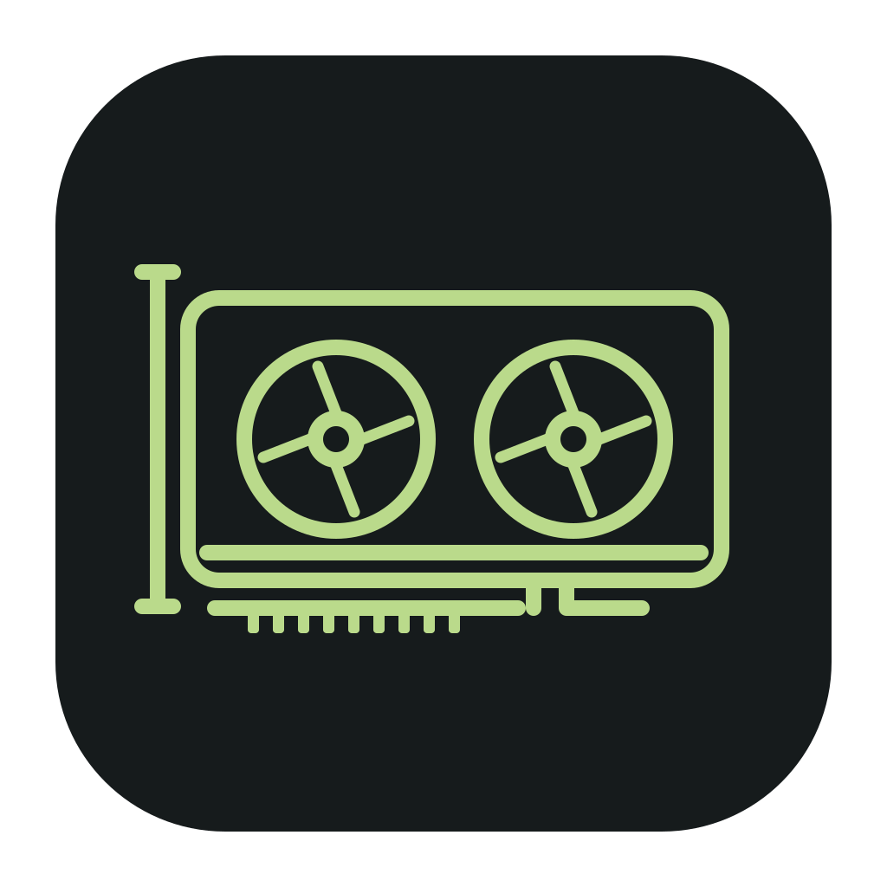
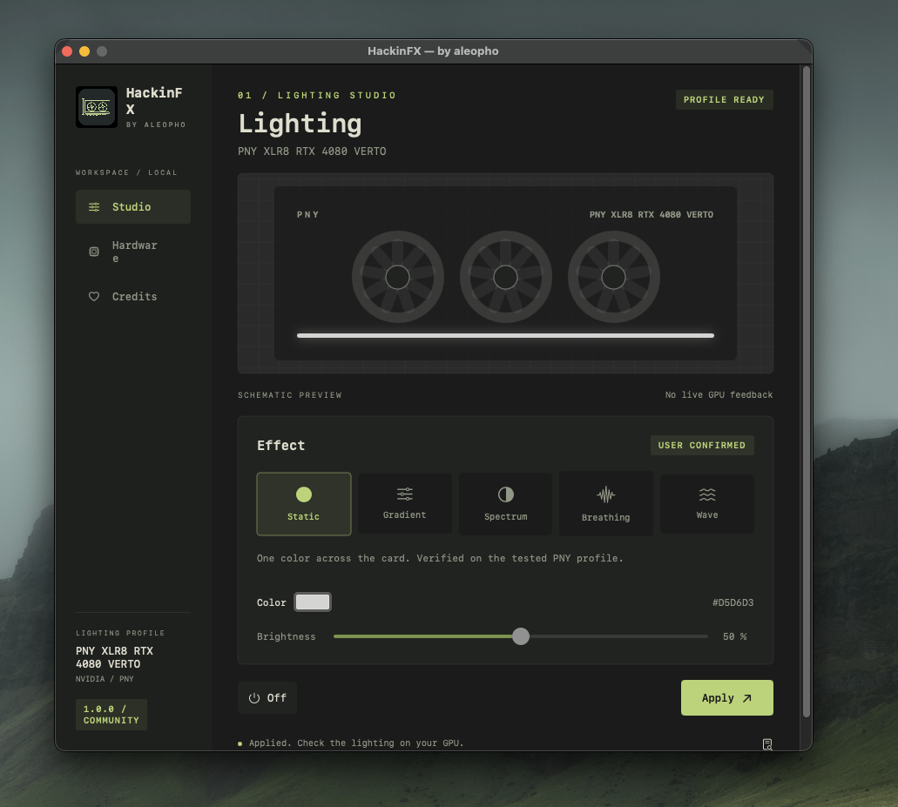

<p align="center"></p>
<h1 align="center">HackinFX</h1>
<p align="center">GPU lighting for Hackintosh systems · by <a href="https://github.com/aleopho">aleopho</a></p>

HackinFX is a native macOS menu-bar app for controlling a supported GPU's RGB lighting through a separately installed NullMoth NVRM driver. It combines a lighting studio, visible hardware detection, a guided visual test, local profiles and community compatibility reports.

**Release 1.1.0 · macOS 15 or later.** Includes a refined native interface, genuine WidgetKit widget and OpenRGB-based NVIDIA controller matching.

The OpenRGB catalog recognizes 752 exact GPU PCI tuples. Executable lighting-test paths currently cover **38 exact configurations across PNY Lovelace, EVGA Pascal and ASUS Aura**. These are test candidates; only cards with successful visual user confirmation are listed as user-tested. Other controller families remain identification-only. [Controller details](docs/RELEASE-1.1.md).

## Download and install

Download [HackinFX 1.1.0 DMG](https://github.com/aleopho/HackinFX/releases/download/v1.1.0/HackinFX-aleopho-1.1.0.dmg), open it and drag **HackinFX.app → Applications**. Quit older copies first, eject the image, then launch the installed app. Checksums and source are included in the release.

Requirements:

- macOS 15 or later on an x86-64 Hackintosh (Intel or AMD CPU); GPU/driver configuration already working. CPU vendor is not a software gate; AMD-CPU systems have not yet been physically validated by this project.
- A compatible, separately installed [NullMoth NVIDIA driver / NVRM service](https://github.com/nullmoth/nvidia-macos-driver).
- A working `/usr/bin/python3` supplied with Apple's command line tools.
- A matching RGB controller profile from the table below.

The app is locally ad-hoc signed. It is not Developer ID signed or notarized; downloaded copies may show a macOS security warning. HackinFX does not disable security settings or remove quarantine flags. Native installation and appearance on Sequoia/Tahoe still need broader community validation.

## Verified hardware

| Card | GPU vendor | Board vendor | PCI / subsystem | Confirmed functions |
| --- | --- | --- | --- | --- |
| PNY XLR8 RTX 4080 VERTO | NVIDIA | PNY | `10de:2704 / 196e:13bc` | Static, Gradient, Spectrum, Breathing, Wave |

CPU vendor and GPU vendor are separate: an AMD CPU is not an AMD graphics card. The x86-64 build is not restricted to Intel CPUs; actual operation still depends on the macOS/NullMoth/GPU configuration. AMD-CPU compatibility has not been physically verified.

These lighting effects were visually confirmed by aleopho on the development card. Off is implemented but has not been separately visually confirmed. A successful driver return value does not prove that LEDs changed.

Other GPUs can be inventoried and reported, but lighting writes remain disabled until a compatible local controller/transport module is implemented and validated. See [compatibility and adding GPUs](docs/COMPATIBILITY.md).

## What the app does

1. Shows a short launch animation, then visibly reads PCI identity and graphics-driver information.
2. Loads a previously confirmed local profile when the hardware/driver/OS fingerprint matches. Older basic-only profiles require the complete test.
3. Otherwise, for an implemented controller, automatically tests red, green, blue and every available effect. PNY offers Gradient, Spectrum, Breathing and Wave; EVGA Pascal/ASUS Aura offer Spectrum and Breathing. Watch the card and confirm complete, partial or no operation. The test can be stopped.
4. Saves a reusable local profile only after completed transport calls and your visual confirmation. Missing or incorrect board/model names can be supplied by the user; detected PCI IDs are preserved.
5. With sharing enabled, queues a minimal compatibility confirmation for the community database. Offline submissions remain local and retry automatically. Private troubleshooting notes require a separate **Review / Send** action.

Closing the window keeps HackinFX in the menu bar. Open Lighting restores it; **Quit HackinFX** exits. Static/zone colors, brightness and effect speed are available in the lighting studio. Gradients use three controller zones; physical placement depends on the card.

## Desktop widget

The genuine WidgetKit widget shows GPU model, last successfully applied lighting mode, a matching color strip and brightness where supported. Add HackinFX from the desktop’s **Edit Widgets** gallery after installing and launching the app. WidgetKit controls refresh timing; the colors are a schematic of the last command, not live LED feedback. Normal desktop registration and update behavior still need community validation with the ad-hoc-signed distribution.

## Screenshots



HackinFX 1.0.0 Lighting Studio with the confirmed PNY XLR8 RTX 4080 VERTO profile. Genuine desktop capture supplied by aleopho; the GPU illustration inside the app is a schematic, not LED-state feedback. [Screenshot details](docs/SCREENSHOTS.md).

## Documentation

- [Installation, first launch and troubleshooting](docs/USER-GUIDE.md)
- [How hardware access and effects work](docs/ARCHITECTURE.md)
- [Compatibility and the process for adding a card](docs/COMPATIBILITY.md)
- [Reports, privacy and the public catalog](docs/PRIVACY.md)
- [Build, tests and release validation](docs/DEVELOPMENT.md)
- [Report server deployment](report-inbox/README.md)
- [Licenses, third-party code and acknowledgements](THIRD-PARTY-NOTICES.md)
- [Release history](CHANGELOG.md)

## Source layout

```text
app/                 SwiftUI/AppKit app, Python transport, profiles, tests, assets
report-inbox/        Cloudflare Worker, D1 schema, migrations and backend tests
docs/                User, architecture, compatibility, privacy and developer docs
licenses/            Preserved third-party notices
LICENSE              Full GPL version 2 text; project permits version 2 or later
```

Build locally with `python3 app/build_community.py`. Package with `python3 app/package_dmg.py`. Full commands and remaining validation limits are in the developer guide.

## Credits and license

Created by **aleopho**. HackinFX application/source: **GPL-2.0-or-later**, see [LICENSE](LICENSE) and [licensing notes](app/LICENSE.md).

- **OpenRGB / yufan and contributors:** PNY Lovelace controller protocol and effect packet adaptation, GPL-2.0-or-later.
- **NullMoth Systems:** separately installed NVRM bridge; the reviewed v2.5.3 NVRM source declares PolyForm Noncommercial 1.0.0. Its driver is not bundled or relicensed by HackinFX.
- **NVIDIA:** public RM SDK ABI definitions, with MIT notices preserved in [licenses/NVIDIA-MIT.txt](licenses/NVIDIA-MIT.txt).

[Full attribution and source references](THIRD-PARTY-NOTICES.md). Independent community project; no endorsement by Apple, NVIDIA, PNY, NullMoth or OpenRGB. Provided without warranty.

Confirmed profiles are saved in the current user’s `~/Documents/HackinFX/` directory, one JSON file per hardware fingerprint. Existing matching profiles are migrated automatically.
