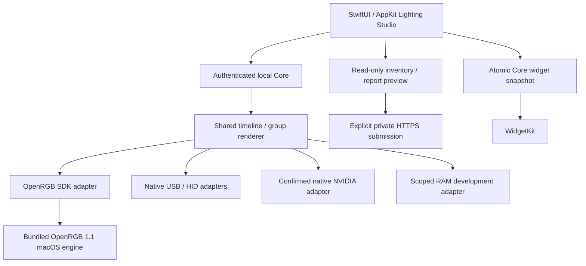

# Lighting Studio architecture

## Components and ownership

`CommunityRGB.swift` owns the native app lifecycle, GPU Lab, reports and menu bar.
`ControlCenter.swift` provides the lighting workspace and authenticated local
client. `center_service.py` hosts the loopback API; `center_core.py` owns adapter
discovery, target validation, scene storage, rendering and output workers.

The managed engine binds a random loopback SDK port, uses private configuration
and is stopped with the Core. The Python SDK client negotiates its supported
protocol and validates bounded controller data. Native ownership excludes
conflicting OpenRGB paths so two backends do not write the same device.
OpenRGB's compiled macOS driver set is included; a Linux/Windows catalog match
is not evidence of an accessible macOS transport.

## Shared effects

A persistent monotonic epoch drives host effects. Default mapping mirrors the
effect per device; optional Canvas mapping incorporates placement. All frames in
an animated synchronized group use the same timestamp. A group barrier waits for
all commands before advancing. An exponential moving average of command duration
helps schedule faster outputs toward common completion. USB minimum intervals
wait instead of silently discarding a frame. Throughput follows the slowest
output, with a maximum target of 20 Hz. Independent output mode retains bounded
latest-frame behavior; it does not promise group alignment.

Command completion is not optical measurement. Firmware buffering, wireless
latency and per-LED transmission can still differ. Hardware-only animations use
their own clocks and are excluded from strict animated groups. Static and
Gradient can be sent to suitable non-streaming outputs.

## Native paths

- NVIDIA: exact PCI/subsystem profiles, NVRM binding and a valid user-confirmed
  profile guard each command. The PNY three-zone path can stream host frames;
  additional controller families retain their own limits. No arbitrary address
  sweeps, firmware writes or flash-save operations are exposed.
- USB/HID: bounded lighting packets for implemented LampArray, ASUS, Radius and
  NZXT paths. ASUS keyboards receive whole-keyboard host-rendered Static packets.
  Radius renews its acknowledged preview lease, including unchanged colors and
  paused animation, without adding cooling/PWM or flash commands.
- RAM: narrowly scoped Corsair/SMBus development path requiring macUSPCIO. Driver
  presence in a package is not proof of a loaded transport or working LEDs.

The installer handles optional OpenCore transport setup separately from the app:
actual boot identification, GPT or MBR/FAT candidates, full EFI backup,
constrained Kernel/Add edit and rollback. It never makes RAM a universal supported
class. Reboot and loaded-driver verification remain necessary.

## Identity, profiles and reports

Read-only inventory projects allowlisted PCI/driver and system-profiler fields.
The native GPU fingerprint includes architecture, OS, PCI/binding and driver
versions. Critical query failures prevent profile reuse; an optional broader
system-inventory failure is recorded without invalidating otherwise valid GPU
identity. Manual model corrections preserve original identity and source labels.

Profiles/scenes live in `~/Documents/HackinFX`; Core state/logs are in Application
Support. Community confirmations use a durable minimal queue. Troubleshooting
reports require exact preview and explicit Send, with a server receipt. Public
compatibility is informational, cannot load code and cannot bypass local guards.
[Privacy and server flow](PRIVACY.md).

## Widget and lifecycle

Core state writes an atomic, bounded WidgetKit snapshot containing mode, palette,
brightness, GPU, ready count and status. Semantic-change writes and throttled
reload requests avoid poll churn. The widget validates data and supplies a
fallback. System scheduling controls actual refresh, not a real-time promise.

Closing the window leaves the menu-bar app running. Quit stops Core workers and
the managed engine; last hardware colors/onboard modes may persist. Host effects
need the running app. CI uses fixtures and self-tests, never real lighting probes.
