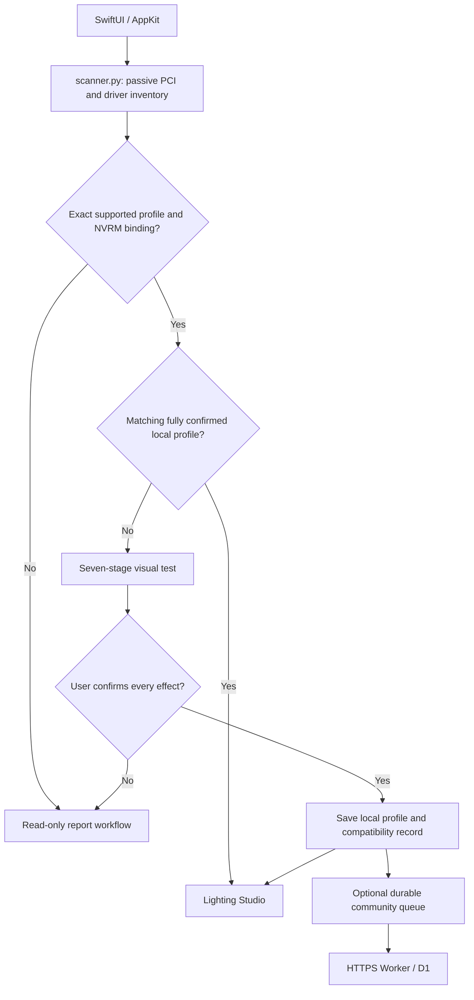

# What HackinFX does

## Components

`CommunityRGB.swift` provides the SwiftUI studio, hardware/setup/report views and AppKit window/menu-bar lifecycle. `SetupSupport.swift` owns Codable profiles, compatibility records and atomic on-disk confirmation queues. Python processes perform passive inventory and the narrowly scoped native driver operations. No embedded OpenRGB executable is required.

## Passive hardware detection

At each program start, after the intro, `scanner.py` runs two read-only system queries: `ioreg -a -r -c IOPCIDevice` and `kextstat`, each with a timeout. It filters display-class PCI devices, records allowlisted IDs/model labels, detects an NVRM child binding and extracts selected graphics-driver identifiers/versions. Raw registry trees, device serial numbers, hostnames and kernel addresses are not exported by this scanner.

GPU vendor and board vendor are distinct: NVIDIA is the GPU vendor on the development card; PNY is its board vendor. An exact bundled subsystem profile supplies the documented board name. Registry model labels can be generic or spoofed and do not prove an LED controller is present. The UI allows a user-supplied manufacturer/model; database records distinguish that correction from original detection.

A SHA-256 configuration fingerprint covers module version, architecture, OS version, selected PCI/binding information and driver versions. Incomplete inventory cannot produce a reusable fingerprint. Unsupported or ambiguous configurations cannot enable lighting. Multiple display adapters can be inventoried, but lighting requires exactly one NVRM-bound matching device.

## Native driver transport

`probe.py` uses Python ctypes to call the installed IOKit NVRM service. It opens control/device user clients, uses external-method selector 1 for permitted RM escapes, allocates a root/device/subdevice/I2C object chain, checks ABI sizes/alignment and validates every return/response size/RM status. Root objects and service connections are cleaned up on errors as well as successful completion. No selector-0 initialization is performed.

`rgb.py` validates the exact PCI subsystem through `profiles.py`, then reads bounded port/DCB metadata before writes. The GUI currently uses the verified RM port 1 and writes only the known PNY LED controller address/register. It sends no address sweeps, firmware updates, voltage/fan changes or general-purpose user-supplied register writes.

The verified profile uses 7-bit address `0x60` (indexed ABI address `0xc0`), register `0x02`, 100 kHz and seven-byte PNY lighting packets. Static/gradient operation writes at most one packet for each of three zone indices. Breathing, Spectrum and Wave use controller-side effects instead of a host animation loop. Calls stop at the first failure. The low-level research CLI retains explicit candidate port selection; it never switches ports automatically. The GUI is fixed to the validated port.

## Test and profile state

For a supported controller without a matching full confirmation, the visible test runs red, green, blue, Gradient, Spectrum, Breathing and Wave. The last observation delay completes before asking the user. Test commands use fixed colors, brightness and speed so previous Studio selections do not alter the sequence. A transport success is recorded as a successful command, not as visual proof. Stop/failure prevents confirmation. There is no optical sensor or LED-state readback.

Full user confirmation plus completed transport and a valid fingerprint saves a local profile. Basic-only legacy profiles do not bypass the full test. Failed retests suppress reuse of old confirmation. Saved profiles are scoped to the exact configuration fingerprint, not all cards with a similar marketing name. Wave remains active after the sequence; the previous controller effect cannot be restored because it is not read back.

## Reports and shared compatibility

The app's private troubleshooting payload and minimal community confirmation have different HTTPS endpoints and database tables. See [privacy and report flow](PRIVACY.md). Atomic queue writes happen before old superseded queue entries are removed. A confirmation file is removed only after a matching server receipt. Failed upload stays local and retries while the app runs or on a later launch/scan.

Public catalog records are informational data. They cannot install code, select an unimplemented controller or override the local PCI/transport guards. A user-reported success is useful evidence for future releases; it is not an independently audited certification.

## Window and process lifecycle

Closing the main window hides the Dock presence and leaves the menu-bar app running. Reopening restores the window; Quit terminates the app. Native subprocesses have watchdog termination, and scanner system queries have their own timeouts. Native effects continue on the controller after the app exits; automatic reset at quit is not implemented.
